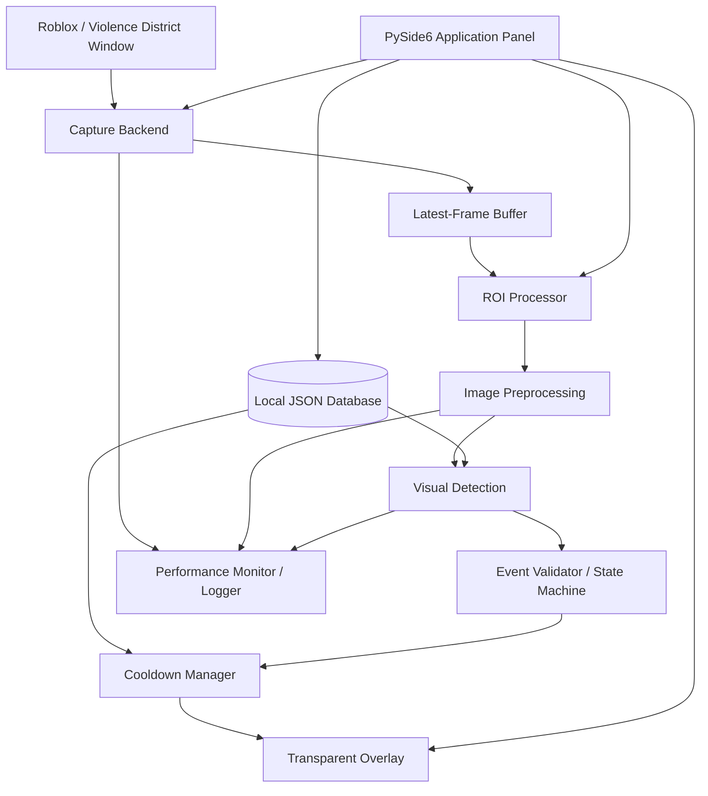
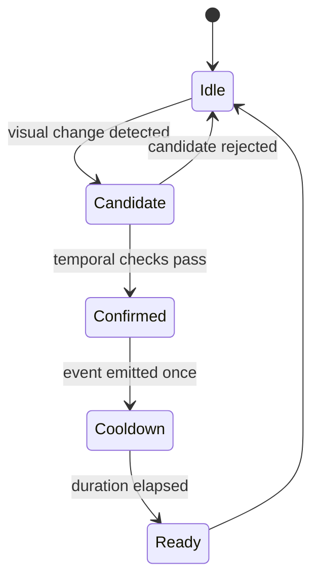

# Architecture — Violence District Cooldown Tracker

## 1. Purpose
This document describes the proposed architecture for the external Computer Vision Cooldown Overlay. It prioritizes a replaceable capture backend, low-latency visual processing, clear module boundaries, and an extensible killer/ability database.

## 2. Architecture Principles
1. **External observation:** use rendered screen output only.
2. **Local-first:** capture and inference run locally.
3. **Low latency:** process recent frames and avoid stale queues.
4. **Separation of concerns:** UI, capture, CV, detection, cooldown logic, and persistence remain independent.
5. **Replaceable components:** capture backend and detection strategy can change behind interfaces.
6. **Incremental intelligence:** begin with deterministic OpenCV methods; add ML only when evidence justifies it.
7. **Graceful degradation:** manual selection and timer controls remain possible if automatic detection is uncertain.

## 3. High-Level Component Diagram



Week 1 validates the path through capture, buffering, ROI, preprocessing, preview, and monitoring. Detection, event validation, cooldown management, and full overlay behavior are later milestones.

## 4. Runtime Data Flow

### 4.1 Capture
1. User selects an available source.
2. Capture backend starts a session.
3. Frames arrive with dimensions and timestamps.
4. The newest frame is published to a bounded buffer.
5. Capture status and metrics are updated.

### 4.2 Processing
1. Processing worker obtains the newest available frame.
2. Older unprocessed frames may be discarded.
3. ROI coordinates are validated against frame dimensions.
4. ROI is cropped.
5. Optional preprocessing is applied.
6. Preview and performance metrics are updated.
7. Later milestones pass the processed ROI to a detector.

### 4.3 Detection and Cooldown (future path)
1. Detector returns a candidate visual state and confidence.
2. Event validator checks temporal consistency and debounce rules.
3. Confirmed event identifies killer/ability configuration.
4. Cooldown manager starts one timer for the event.
5. Overlay renders remaining time and READY state.

A candidate detection must not directly create repeated cooldown timers without event validation.

## 5. Module Responsibilities

| Module | Responsibility | Must not do |
|---|---|---|
| `capture` | Acquire frames, source lifecycle, timestamps | Perform killer/ability inference |
| `processing` | ROI crop and image preprocessing | Manage cooldown state |
| `detection` | Return visual candidates and confidence | Render UI or own timers |
| `cooldown` | Manage ability cooldown state and timer lifecycle | Capture screen |
| `overlay` | Render transparent UI and receive display state | Run expensive CV |
| `database` | Load, validate, and save local data | Contain detection algorithms |
| `monitoring` | Log events and measure performance | Mutate game state |
| `app` | Compose components and application lifecycle | Become a monolithic implementation |

## 6. Proposed Project Structure

```text
ViolenceDistrictTracker/
├── main.py
├── requirements.txt
├── README.md
├── PRD.md
├── AGENTS.md
├── ARCHITECTURE.md
├── TODO.md
├── WORKFLOW.md
├── app/
│   ├── __init__.py
│   ├── application.py
│   └── settings.py
├── capture/
│   ├── __init__.py
│   ├── capture_interface.py
│   ├── windows_capture.py
│   └── frame_buffer.py
├── processing/
│   ├── __init__.py
│   ├── roi_processor.py
│   ├── preprocessing.py
│   └── template_matcher.py
├── detection/
│   ├── __init__.py
│   ├── killer_detector.py
│   ├── ability_detector.py
│   └── event_recognition.py
├── cooldown/
│   ├── __init__.py
│   └── cooldown_manager.py
├── overlay/
│   ├── __init__.py
│   ├── overlay_window.py
│   ├── cooldown_widget.py
│   └── overlay_controller.py
├── database/
│   ├── __init__.py
│   ├── database_manager.py
│   └── killer_database.json
├── config/
│   └── app_config.json
├── monitoring/
│   ├── __init__.py
│   ├── performance_monitor.py
│   └── logger.py
├── assets/
│   └── templates/
├── dataset/
│   └── README.md
└── tests/
    ├── test_capture.py
    ├── test_roi.py
    └── test_database.py
```

Create modules incrementally. Empty placeholder files are not a substitute for working functionality.

## 7. Capture Backend Abstraction

Define a small capture interface. Conceptual example:

```python
class CaptureBackend:
    def start(self, source_id: str) -> None:
        ...

    def get_frame(self):
        # Return newest frame plus capture timestamp, or None.
        ...

    def stop(self) -> None:
        ...
```

The actual interface should include typed frame metadata and explicit error/status handling.

### Backend candidates
- **Windows.Graphics.Capture (WGC):** technical spike for application-window/display capture.
- **DXGI Desktop Duplication:** alternative to test for frame acquisition and performance.

Choose based on measured compatibility with target Roblox display mode, frame delivery, stability, and Python integration effort. Do not assume either API works in every fullscreen or anti-cheat configuration.

## 8. Threading and Frame Buffer

Recommended separation:
- UI thread: PySide6 event loop and widget updates.
- Capture worker: obtains frames and timestamps.
- Processing worker: consumes latest frame, applies ROI and preprocessing.
- Future inference worker: only if model inference is expensive enough to require isolation.

Use a bounded latest-frame buffer. A capacity of one or two frames is a reasonable starting experiment. The consumer should prefer the newest frame instead of processing an ever-growing queue.

Never update Qt widgets directly from a worker thread. Use signals or appropriate Qt thread-safe communication.

Shutdown order:
1. Stop accepting new capture frames.
2. Signal workers to stop.
3. Stop capture session.
4. Wait for workers to finish.
5. Release image/buffer resources.
6. Close UI.

## 9. Image Processing Pipeline

```text
Raw Frame
  -> Validate Frame
  -> ROI Crop
  -> Optional Resize
  -> Optional Grayscale
  -> Optional Contrast / Threshold Experiment
  -> Preview / Template Matching Experiment
```

Keep preprocessing configurable. Avoid irreversible transformations before collecting comparison results.

### Template matching
Initial baseline: OpenCV `TM_CCOEFF_NORMED`.

Store templates as assets with metadata describing:
- Killer ID.
- Ability ID or visual state.
- Resolution/scale assumptions.
- Capture conditions.
- Template version.

Thresholds must be empirically selected from representative positive and negative footage.

### Machine learning escalation
Use YOLO only when object localization is required and template matching/classification is insufficient. Use temporal methods for animation recognition. Keep model inference behind a detector interface so it can be replaced without changing cooldown or overlay modules.

## 10. Event Recognition and Cooldown State

Future event pipeline:



Requirements:
- Confidence threshold.
- Multi-frame confirmation.
- Debounce window.
- Duplicate-event suppression.
- Configurable cooldown duration.
- Manual start/reset fallback.
- Explicit READY and COOLDOWN states.

Do not treat configured duration as authoritative server state. It is an estimated timer based on local configuration and visible event.

## 11. Data Model

Suggested JSON shape:

```json
{
  "schema_version": 1,
  "game": "Violence District",
  "killers": [
    {
      "id": "the_hidden",
      "name": "The Hidden",
      "abilities": [
        {
          "id": "leap",
          "name": "Leap",
          "cooldown_seconds": 25,
          "enabled": true,
          "detection": {
            "method": "template_matching",
            "template": "assets/templates/the_hidden/leap_ready.png"
          }
        }
      ]
    }
  ]
}
```

The cooldown shown is an example value only. Verify it in the current game and keep it editable.

### Configuration rules
- IDs are stable, lowercase, and machine-friendly.
- Display names are user-facing.
- Durations are numeric seconds.
- JSON has a schema version.
- Missing/invalid data produces a readable error.
- Adding a killer should require data/configuration first, not edits throughout the codebase.

## 12. Overlay Architecture

PySide6 owns overlay window and rendering. OpenCV does not own desktop window lifecycle.

Overlay requirements:
- Transparent background.
- Always-on-top where supported.
- Configurable position and size.
- Click-through mode when enabled.
- No expensive image processing in UI thread.
- UI receives display-ready cooldown state from cooldown controller.

Test click-through behavior with the actual target environment. Window flags and platform behavior can differ.

## 13. Performance and Observability

Record at minimum:
- Capture FPS.
- Processing FPS.
- Frame dimensions.
- ROI dimensions.
- Processing time per frame.
- CPU usage of this application.
- RAM usage of this application.
- Capture errors/restarts.
- Detection confidence and event timestamps once detection exists.

Use monotonic clocks for elapsed-time measurement. Keep logs bounded or rotate them.

Performance targets from PRD are targets, not guarantees. Every report must include machine specifications, display resolution, game mode, and test duration.

## 14. Security and Platform Constraints

Allowed architecture:
- Public Windows capture APIs.
- Local image processing.
- Local JSON configuration.
- External overlay window.

Prohibited:
- Process injection or hooking.
- Reading Roblox process memory.
- Executors or exploit APIs.
- Modifying Roblox client files.
- Bypassing anti-cheat.
- Automated game input.

Screen capture does not guarantee policy approval. Do not describe overlay hiding or capture exclusion as an anti-cheat bypass.

## 15. Architecture Decision Records

| Decision | Current position | Revisit when |
|---|---|---|
| Primary language | Python | User approves stack change |
| Desktop UI | PySide6 | Concrete platform limitation is demonstrated |
| CV baseline | OpenCV | Measurements show learned model is necessary |
| Initial storage | JSON | Data complexity requires database features |
| Capture backend | MSS / Win32 BitBlt provisional backend (27.58ms @ 35.4 FPS), behind modular interface | Evaluate WGC/DXGI in-game if occlusion or higher FPS is strictly required |
| Initial detector | Template matching experiment | Actual HUD footage demonstrates limitations |
| First ability | The Hidden — Leap | First MVP path is validated |
