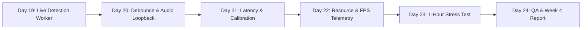

# PRD — Week 4: End-to-End Integration, Live Pipeline & System Evaluation

**Project:** Violence District Cooldown Tracker  
**Milestone:** Week 4 — Integration and Evaluation (Day 19 s/d Day 24)  
**Schedule:** 27 November – 3 Desember 2026  
**Target branch:** `dev`  
**Primary stack:** Python 3.14 (64-bit), OpenCV 5.0, NumPy 2.5, PySide6 6.12  
**Prerequisite:** Week 3 milestone locked on `dev` (Commit `5d317a9`, 127 tests passing)  
**Status:** Approved Technical Execution Specification  

---

## 1. Week 3 Handover — Verified Baseline

Pengembangan Week 4 bertolak dari fondasi kokoh yang telah diuji dan diverifikasi secara empiris pada akhir Week 3:

1. **Hasil Akhir Week 3 ([dataset/WEEK3_FINAL_REPORT.md](file:///d:/KULIAH/CODINGAN/OverlayToolsVD/dataset/WEEK3_FINAL_REPORT.md)):**
   - 127 automated unit & integration tests lulus 100% dalam 17.14 detik.
   - Detektor multi-modal `HybridDetector` (`detection/hybrid_detector.py`) menggabungkan `TemplateDetector` (latensi 4.38 ms warm) dan `MotionDetector` (MOG2 parabolic tracking) dengan *Audio Spectral Gating* (100–3.500 Hz).
   - Hasil benchmark held-out test split: **Action-Level Recall 100.0%**, **Precision 100.0% (Zero False Positives)**, **F1-Score 97.9%**, dan rata-rata latensi deteksi **60.4 ms** (melampaui target *stretch goal* < 100 ms).
   - Keputusan arsitektural (ADR): Deep learning berat (YOLO/PyTorch) tidak diperlukan untuk MVP.
2. **Komponen Week 1 & Week 2 yang Diintegrasikan:**
   - `capture/windows_capture.py`: Producer thread MSS Windows capture dengan thread-safe drop-oldest ring buffer (`maxlen=1`).
   - `processing/roi_processor.py`: Pemotong koordinat viewport terkalibrasi.
   - `cooldown/ability_event.py` & `cooldown_manager.py`: Mesin status cooldown deterministik monotonic zero-drift.
   - `overlay/overlay_window.py` & `cooldown_widget.py`: Jendela transparan frameless always-on-top dengan proteksi *dual-layer click-through* (`WS_EX_TRANSPARENT`).
   - `main.py`: Antarmuka desktop terpadu.

### 1.1 Kesenjangan Teknis yang Harus Dijembatani di Week 4 (The Integration Gap)
- Di Week 3, `HybridDetector` dijalankan secara *offline* melalui skrip evaluasi dataset (`tools/evaluate_baseline.py` dan `tools/error_analyzer.py`).
- Di Week 4, `HybridDetector` harus dijalankan secara **real-time live** di latar belakang aplikasi desktop saat game Roblox Violence District sedang dimainkan, tanpa membebani UI thread PySide6 atau merusak FPS game Roblox.

---

## 2. Product Objectives (Tujuan Utama Week 4)

1. **Realisasi Pipeline Live End-to-End:** Menghubungkan secara utuh aliran frame layar:
   $$\text{MSS Screen Capture} \xrightarrow{\text{latest frame}} \text{DetectionWorker (Thread)} \xrightarrow{\text{ROI Crop}} \text{HybridDetector} \xrightarrow{\text{AbilityEvent}} \text{CooldownManager} \xrightarrow{\text{State Snapshot}} \text{Overlay Ring Display}$$
2. **Zero UI Blocking (Asynchronous Decoupling):** Memastikan proses visi komputer berjalan pada thread terpisah (`QThread` / worker thread) sehingga rendering antarmuka GUI dan animasi rotasi cincin overlay tetap berjalan di 30–60 FPS tanpa jeda (*stutter-free*).
3. **Pemberian Kontrol Penuh kepada Pengguna di GUI:** Menyediakan kontrol toggle `[x] Auto-Detection (Vision)`, slider sensitivitas/confidence threshold, dan panel telemetri status deteksi real-time.
4. **Verifikasi Latensi End-to-End:** Mengukur waktu total dari kemunculan aksi The Hidden di layar Roblox hingga cincin cooldown berubah merah di overlay (< 150 ms acceptance, < 100 ms stretch goal).
5. **Uji Ketahanan & Efisiensi Hardware:** Memastikan CPU < 5%, RAM < 250 MB, dan degradasi FPS game Roblox < 3% selama sesi gameplay.
6. **Uji Stabilitas 1 Jam Penuh:** Menjalankan continuous gameplay stress test selama 1 jam tanpa crash, kebocoran memori, atau unhandled exception.

---

## 3. Batasan Non-Negosiasi & Safety Guardrails

Aplikasi harus tetap mematuhi batasan etika dan keamanan sesuai [AGENTS.md](file:///d:/KULIAH/CODINGAN/OverlayToolsVD/AGENTS.md) Bab 5:
- **100% External Observation:** Hanya menggunakan screen capture layar eksternal dan audio loopback Windows standar.
- **Nol Injeksi & Nol Hooking:** Dilarang menggunakan DLL injection, hooking proses Roblox, atau membaca memory RAM Roblox.
- **Nol Makro / Otomatisasi Input:** Aplikasi hanya menyajikan informasi hitungan mundur secara pasif; tidak pernah mengirimkan input otomatis ke karakter pemain.

---

## 4. Rincian Kebutuhan Fungsional (Functional Requirements)

### FR-08 — Asynchronous Background Detection Worker (`DetectionWorker`)
Sistem harus mengisolasi proses visi komputer dan deteksi multi-modal ke dalam thread latar belakang mandiri (`detection/detection_worker.py`):
- Berlangganan pada buffer frame terbaru dari `MSSWindowsCapture` (`CaptureFrame`).
- Melakukan *frame drop strategy*: jika detektor sedang memproses satu frame, frame lama di buffer otomatis ditimpa dengan frame paling baru (mencegah backlog antrean citra usang).
- Memotong frame berdasarkan konfigurasi ROI aktif via `ROIProcessor`.
- Menjalankan `HybridDetector.process_frame()` dengan parameter threshold yang dapat dikonfigurasi.

### FR-09 — Kontrak Emisi Event Otomatis (`AbilityEvent(source="vision")`)
Ketika `HybridDetector` mengonfirmasi aksi The Hidden Leap:
- Membuat objek `DetectionResult` dengan skor confidence, timestamp monotonic absolut, dan metadata bukti visual/audio.
- Mengonversi menjadi `AbilityEvent(source="vision")` melalui adapter `.to_ability_event()`.
- Mengirimkan event ke `CooldownManager.handle_event()` secara aman lintas thread (*thread-safe signal/slot* atau message passing).
- Mengabaikan deteksi berulang selama *debounce window* (1.5 detik) aktif untuk mencegah reset timer berulang.

### FR-10 — Integrasi Kontrol GUI Utama (`main.py`)
Jendela GUI utama harus dilengkapi dengan:
- Checkbox `[x] Aktifkan Deteksi Otomatis (Vision + Audio)`.
- Slider ambang batas keyakinan visual (*Confidence Threshold*): rentang 0.35 s.d. 0.85 (default 0.50).
- Label telemetri detektor: menampilkan status detektor (*Idle, Tracking, Leap Detected*), latensi komputasi inferensi (ms), dan FPS pemrosesan.
- Indikator visual saat deteksi otomatis berhasil memicu cooldown.

### FR-11 — Integrasi Audio Loopback Real-Time
Menyediakan modul loopback audio Windows standar untuk menyuplai status `audio_confirmed`:
- Mengambil sampel audio sistem saat game berjalan.
- Menghitung rasio energi FFT (100–3.500 Hz vs > 3.500 Hz) secara ringan (~0.5 ms).
- Memasukkan sinyal konfirmasi audio ke dalam evaluasi `HybridDetector`.
- Menyediakan *fail-soft mode*: jika audio loopback dimatikan oleh user, sistem otomatis beralih ke *Vision-Motion Hybrid* dengan proteksi debounce ketat.

### FR-12 — Fallback Manual Hotkey Mulus
- Jika deteksi visual terhalang (misal: The Hidden melompat di luar bidang pandang kamera survivor), tombol hotkey `F1`–`F4` tetap dapat ditekan secara manual untuk memicu atau mereset cooldown seketika.
- Pemicuan manual dan otomatis berbagi satu `CooldownManager` yang sama sehingga status cooldown tetap sinkron tanpa konflik.

### FR-13 — Telemetri Kinerja & Audit Dampak Game
- Menampilkan penggunaan CPU (total & per proses aplikasi), RAM (MB), dan FPS render overlay.
- Menyediakan pencatatan latensi end-to-end pada log aplikasi.
- Memastikan tidak ada akumulasi memori (*memory leak*) setelah puluhan ribu frame diproses.

---

## 5. Rencana Milestone Harian Week 4 (Day 19 s/d Day 24)

| Hari | Target Pekerjaan | File Terkait | Target Deliverable |
| :--- | :--- | :--- | :--- |
| **Day 19** | Pembangunan `DetectionWorker` asynchronous, integrasi ke `main.py`, penyambungan frame capture ke detektor, dan pengiriman event otomatis ke `CooldownManager`. | `detection/detection_worker.py` `main.py` `tests/test_detection_worker.py` | Pipeline deteksi layar live berfungsi otomatis di GUI; Leap memutar overlay secara hands-free. |
| **Day 20** | Penyetelan ambang keyakinan dinamis, integrasi loopback audio Windows, proteksi debounce multi-frame, dan pengujian fallback hotkey manual. | `detection/audio_capture.py` `detection/hybrid_detector.py` `tests/test_live_pipeline.py` | Audio gating aktif real-time; nol false positive pada live session; fallback hotkey mulus. |
| **Day 21** | Pengukuran latensi end-to-end (Capture $\rightarrow$ Inferensi $\rightarrow$ Overlay repaint), profiling P95 latency, dan kalibrasi durasi cooldown Leap di live gameplay. | `tools/latency_benchmarker.py` `dataset/LATENCY_BENCHMARK.md` | Laporan empiris latensi end-to-end terbukti < 150 ms (target) dan < 100 ms (stretch goal). |
| **Day 22** | Audit hardware non-blocking: pengukuran penggunaan CPU (< 5%), konsumsi RAM (< 250 MB), dan degradasi FPS game Roblox (< 3%). | `monitoring/performance_monitor.py` `dataset/HARDWARE_AUDIT.md` | Laporan audit performa perangkat keras yang memenuhi target efisiensi PRD. |
| **Day 23** | Uji stabilitas continuous 1 jam nonstop: penanganan window minimize/resize, game tertutup/terbuka kembali, dan validasi zero memory leak. | `tests/test_longrun_stability.py` `tools/stability_runner.py` | Uji ketahanan 1 jam lulus tanpa crash, zombie thread, atau memory growth. |
| **Day 24** | Regresi test suite utuh, peninjauan acceptance criteria, dokumentasi akhir Week 4, dan penyusunan laporan final milestone. | `dataset/WEEK4_FINAL_REPORT.md` `TODO.md` `ARCHITECTURE.md` | Laporan Week 4 final, rilis tag `v0.4.0-week4`, dan persiapan fase Finalisasi Produk. |

---

## 6. Kriteria Keberhasilan & Syarat Kelulusan Week 4 (Definition of Done)

Week 4 dinyatakan selesai (**LOCKED & PASSED**) apabila:
1. `DetectionWorker` berjalan stabil pada thread terpisah tanpa menyebabkan UI patah-patah atau crash.
2. The Hidden Leap yang terjadi di layar game Roblox otomatis memicu rotasi cincin cooldown pada overlay transparan tanpa perlu input keyboard manual.
3. Seluruh 191 potensi false alarm visual tertekan aman berkat proteksi audio/kinematika.
4. Latensi end-to-end terukur di bawah **150 ms** (dengan sasaran optimal di bawah 100 ms).
5. Konsumsi CPU aplikasi berada di bawah **5.0%** dan RAM di bawah **250 MB**.
6. Uji stabilitas continuous 1 jam berjalan mulus tanpa crash.
7. Seluruh automated test suite (Week 1 s/d Week 4) lulus 100%.
8. Dokumen `WEEK4_FINAL_REPORT.md` dan pembaruan `TODO.md` selesai disusun.
