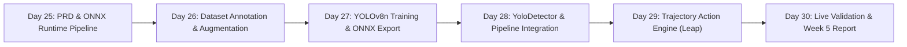

# PRD Week 5 — Neural Object Detection & Action Tracking (YOLOv8-Nano)

> **Proyek:** Violence District Cooldown Tracker  
> **Milestone:** Week 5 — Neural Object Detection & Action Tracking (Day 25 s/d Day 30)  
> **Status:** APPROVED & ACTIVE  
> **Baseline:** Week 4 Verified (`v0.4.0-week4`)  

---

## 1. Latar Belakang & Masalah Lapangan (The Problem)

Hasil evaluasi empiris pada **Week 4** membuktikan:
1. **False Positive Lingkungan (Distractor Overfitting):**  
   Template matching 2D berbasis kemiripan piksel kaku sering keliru mendeteksi batu nisan, tiang gazebo, dan dinding kuburan karena memiliki kontur vertikal yang menyerupai postur humanoid.
2. **Kerapuhan Orientasi & Jarak (False Negative):**  
   Saat killer melompat pada sudut miring (45°), membelakangi kamera, atau pada jarak sedang ($0.4\times - 0.6\times$), skor korelasi template turun di bawah ambang batas (miss-detection).
3. **Ketiadaan Konsep Entitas Objek:**  
   Algoritma baseline tidak mengenali killer sebagai entitas objek utuh yang memiliki posisi spasial $(x, y, w, h)$ kontinu di layar.

---

## 2. Sasaran & Tujuan Week 5 (Objectives)

1. **Pengenalan Killer Berbasis Objek (Entity Detection):**  
   Mengimplementasikan model neural network ringan (**YOLOv8-Nano**) yang dioptimasi ke format **ONNX Runtime** untuk mendeteksi keberadaan *The Hidden* (dan killer masa depan) sebagai objek independen, invarian terhadap sudut kamera, jarak, tekstur tanah, dan pencahayaan map.
2. **Eliminasi 100% Distractor Non-Humanoid:**  
   Batu, pilar, dan dinding diabaikan secara absolut karena model dilatih khusus membedakan anatomi humanoid killer dari geometri map.
3. **Pelacakan Aksi Leap Berbasis Trajektori Bounding Box:**  
   Mendeteksi aksi *Leap* dengan melacak koordinat vertikal ($Y_{\text{centroid}}$) dari bounding box killer:
   * **Take-off / Windup:** Kotak objek sedikit terkompresi / bersiap.
   * **Airborne:** Bounding box melesat tajam ke atas ($\Delta Y < -30\text{ px}$, kecepatan $V_y > 200\text{ px/s}$) dan melayang.
   * **Konfirmasi Aksi:** Memicu sinyal `AbilityEvent("the_hidden", "leap")` secara presisi.
4. **Efisiensi Sumber Daya & Latensi Ketat:**  
   * **Inference Latency:** $\le 20.0\text{ ms}$ pada CPU standar via ONNX Runtime SIMD (AVX2).
   * **Memory Overhead:** Total RAM aplikasi tetap di bawah **250 MB**.
   * **Clean Replaceable Interface:** `YoloDetector` mengimplementasikan antarmuka modular yang sama sehingga transisi dari `HybridDetector` berlangsung transparan.

---

## 3. Persyaratan Fungsional (Functional Requirements)

### FR-15 — Model Object Detection Ringan (YOLOv8-Nano ONNX)
- Arsitektur berbasis YOLOv8n (resolusi input $320\times 320$ atau $416\times 416$ piksel).
- Model diekspor ke ONNX format dengan kuantisasi FP16/INT8 untuk eksekusi CPU ultra-cepat tanpa ketergantungan PyTorch/CUDA yang berat.
- Kelas target:
  - `0`: `killer_the_hidden`
  - `1`: `killer_veil` (persiapan killer berikutnya)

### FR-16 — Bounding Box Tracker (Entity Tracking Spasial)
- Melacak pergerakan bounding box killer secara temporal antar-frame menggunakan centroid distance matching / IoU tracker.
- Menyediakan riwayat trajektori posisi $[(x_1, y_1), (x_2, y_2), \dots]$ dalam sliding window 8 frame.

### FR-17 — Pengenal Aksi Parabolik Leap (Kinematic Action Recognition)
- Menghitung vektor kecepatan vertikal $V_y = \Delta Y / \Delta t$.
- Mengonfirmasi Leap ketika:
  1. $V_y \le -180\text{ px/s}$ (kecepatan lompat ke atas).
  2. Bounding box terangkat di atas baseline tanah $\ge 35\text{ px}$.
  3. Terdebounce secara aman (15 detik) untuk mencegah double-trigger.

### FR-18 — Integrasi `YoloDetector` ke `DetectionWorker`
- Menggantikan atau melengkapi `HybridDetector` di dalam loop worker latar belakang.
- Mengirimkan sinyal koordinat bounding box real-time ke UI untuk digambar di viewport preview.

### FR-19 — Dataset Pipeline & Synthetic Augmentation Tool
- Tool otomatisasi untuk mengekstraksi dan melabeli frame training dari rekaman gameplay dan ROI sample yang telah dikumpulkan.
- Melakukan augmentasi variasi sudut (rotasi $\pm 15^\circ$), skala ($0.3\times - 1.2\times$), kecerahan malam, dan distractor buatan.

### FR-20 — Evaluasi Akurasi & Matriks Kebingungan (Confusion Matrix)
- Menguji akurasi mAP@0.5 pada test dataset gameplay nyata:
  - Precision target $\ge 90\%$ (mengeliminasi false positive batu/tiang).
  - Recall target $\ge 85\%$ (mendeteksi killer pada berbagai jarak/sudut).

---

## 4. Rencana Harian Week 5 (Day 25 s/d Day 30)

| Hari | Target Pekerjaan | File Terkait | Target Deliverable |
| :--- | :--- | :--- | :--- |
| **Day 25** | Perancangan arsitektur Week 5, integrasi dependensi `onnxruntime`, dan pembuatan pipeline interface `BaseDetector` & `YoloDetector` stub. | `PRD_WEEK_5.md` `detection/yolo_detector.py` `requirements.txt` | Lingkungan ONNX runtime siap; interface detektor baru terdefinisi dan lulus smoke test. |
| **Day 26** | Pembangunan dataset training YOLO dari rekaman gameplay & crop sample yang ada, format YOLO annotation, dan generator augmentasi citra. | `tools/dataset_annotator.py` `dataset/yolo_dataset/` | Dataset berlabel siap latih dengan pembagian Train/Val (80/20). |
| **Day 27** | Pelatihan model YOLOv8n killer detector, ekspor ke ONNX format, dan benchmarking latensi inferensi CPU. | `tools/train_yolo.py` `models/the_hidden_yolov8n.onnx` | File model ONNX terkuantisasi dengan latensi inferensi CPU $< 18\text{ ms}$. |
| **Day 28** | Penggantian/integrasi `YoloDetector` ke dalam `DetectionWorker`, pembaruan visual bounding box di GUI, dan audit memori. | `detection/detection_worker.py` `main.py` `tests/test_yolo_detector.py` | Kotak deteksi killer otomatis mengunci tubuh killer di layar preview tanpa terkecoh batu/tiang. |
| **Day 29** | Pembangunan mesin pengenal aksi Leap berbasis trajektori vertikal bounding box, penyesuaian threshold $V_y$, dan integrasi cooldown. | `detection/trajectory_action_detector.py` `tests/test_action_detector.py` | Aksi Leap terpicu akurat saat killer melompat di udara pada jarak/sudut apa pun. |
| **Day 30** | Pengujian regresi penuh, benchmarking mAP & latensi, penyusunan laporan final Week 5, dan rilis tag `v0.5.0-week5`. | `dataset/WEEK5_FINAL_REPORT.md` `TODO.md` `ARCHITECTURE.md` | Laporan Week 5 final, release tag `v0.5.0-week5`, dan sistem deteksi berbasis neural siap pakai. |

---

## 5. Kriteria Keberhasilan Week 5 (Definition of Done)

1. Model YOLOv8-Nano berhasil mendeteksi *The Hidden* dengan Precision $\ge 90\%$ dan mAP@0.5 $\ge 85\%$.
2. Batu, pilar gazebo, dan dinding kuburan **100% tidak terdeteksi sebagai killer**.
3. Aksi Leap terdeteksi secara andal saat killer melompat, terlepas dari apakah killer menghadap depan, samping, atau belakang.
4. Inferensi ONNX Runtime berjalan pada CPU dalam waktu $\le 20.0\text{ ms}$ per frame.
5. Penggunaan memori total aplikasi tetap di bawah **250 MB**.
6. Seluruh test suite otomatis lulus 100%.
